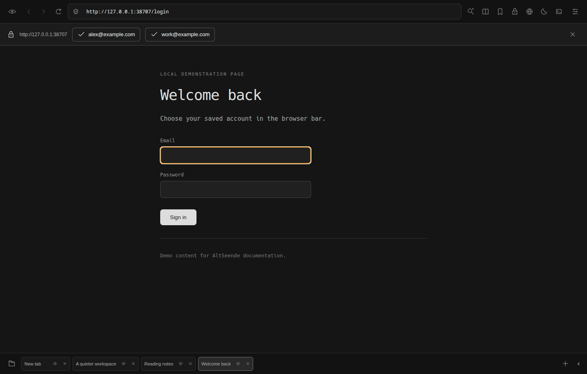

# AltSeende Browser

Минималистичный браузер на Chromium для Linux. Чёрный интерфейс, вкладки снизу, несколько страниц в одном окне. Интерфейс приложения — на английском.

**Версия 0.5.0** · [Скачать](https://github.com/DanielSnadon/AltSeendeBrowser/releases/latest) · [Что нового](RELEASE_NOTES.md)


## Установить и запустить

**Fedora:** скачайте RPM из [Releases](https://github.com/DanielSnadon/AltSeendeBrowser/releases/latest), откройте терминал в папке с файлом и выполните:

```bash
sudo dnf install ./AltSeende-0.5.0-x86_64.rpm
```

После установки откройте **AltSeende Browser** из меню приложений. Эта же команда обновляет старую версию; удалять её заранее не нужно. Перед обновлением закройте браузер.

**Без установки:** скачайте AppImage, разрешите выполнение файла и запустите его:

```bash
chmod +x AltSeende-0.5.0-x86_64.AppImage
./AltSeende-0.5.0-x86_64.AppImage --appimage-extract-and-run
```

Готовые сборки рассчитаны на **Linux x64**. Node.js для запуска не нужен. Если GitHub просит войти, используйте аккаунт с доступом к репозиторию.

## Начать пользоваться

- Введите запрос или адрес в строку поиска. `Ctrl+L` переводит курсор в адресную строку.
- Под поиском: **папка** открывает сохранённые наборы вкладок, **закладка** — сохранённые страницы, **лупа** — расширенный поиск.
- **Свайп вправо** возвращает назад, влево — вперёд. Поддерживаются горизонтальная прокрутка тачпадом и касания экрана. Направление прокрутки тачпада зависит от системных настроек. В полях ввода и прокручиваемых горизонтальных блоках жест не перехватывается.
- `Ctrl+K` открывает **Command palette**: начните вводить название инструмента и нажмите Enter.
- Значок **ползунков справа вверху** открывает **Control center** — все инструменты и инструкции. Настройки находятся в **Preferences**.


## Пароли: выбрать аккаунт одним нажатием

1. Откройте **Control center → Passwords** и создайте мастер-пароль.
2. Добавьте адрес сайта, логин и пароль. Повторное сохранение того же сайта и логина обновляет запись.
3. На сайте нажмите поле входа. Под адресной строкой появятся подходящие аккаунты — выберите нужный.
4. Если хранилище закрыто, нажмите **Unlock passwords** и введите мастер-пароль.



Пароль подставляется только после вашего выбора, для того же адреса сайта — протокола, имени хоста и порта. Форма не отправляется автоматически. Хранилище блокируется после пяти минут без обращения к нему. Автоматические предложения не показываются в приватных вкладках и внутри iframe; ручное заполнение доступно через Passwords для основной страницы.

Сохранение новых паролей пока ручное. Восстановления мастер-пароля и облачной синхронизации нет. Предложения и жесты можно отключить в **Preferences**.

## Несколько страниц одновременно

Нажмите значок **разделённого окна** на верхней панели. Выберите 2–6 страниц и число колонок. Настройки открывать не нужно.

В **Multi-search** введите запрос и нажмите большую кнопку поиска: Google, Yandex, DuckDuckGo, Bing, Brave и Yahoo откроются в сетке **3 × 2**. Кнопка с галочкой использует только отмеченные поисковики.


## Ещё десять инструментов в 0.5

| Инструмент | Что делает |
| --- | --- |
| Command palette | Быстрый запуск функций через `Ctrl+K` |
| Keyboard tabs | `Ctrl+Tab` / `Ctrl+Shift+Tab`, `Ctrl+1–8`, `Ctrl+9` |
| Close other tabs | Оставляет текущую и закреплённые вкладки |
| Close tabs to the right | Закрывает незакреплённые вкладки справа |
| Remove duplicate tabs | Удаляет повторные адреса, разделяя обычные и приватные вкладки |
| Mute other tabs / restore | Отключает звук остальных; повторное нажатие возвращает прежнее состояние |
| Reload all tabs | Обновляет все открытые страницы |
| Save offline page | Сохраняет страницу в один файл MHTML |
| Site controls | Показывает сведения о сайте и позволяет очистить его данные |
| Bookmark all tabs | Сохраняет все обычные страницы в закладки без дубликатов |

Все инструменты доступны через **Control center**, **Command palette** и настраиваемую панель. Закрытие или обновление вкладок может потерять несохранённые формы. Для открытия MHTML используйте браузер с поддержкой этого формата; интерактивные части сайта могут требовать интернет.

## Полезно знать

- **VPN & connection** требует ваш рабочий серверный профиль. Поддерживаются VLESS/REALITY, VMess, Trojan, Shadowsocks, SOCKS5 и HTTP(S). Подключение действует внутри браузера; доступ к каждому заблокированному сайту не гарантирован.
- **Network sign-in** открывает отдельное окно для входа в Wi-Fi-сеть через прямое соединение.
- Блокировщик рекламы, QR-коды, тёмная тема сайтов, заметки, группы, история и громкость вкладок доступны в пункте управления.
- [Данные и ограничения](docs/PRIVACY.md) · [Сборка и проверка](docs/DEVELOPMENT.md) · [Сторонние компоненты](THIRD_PARTY.md)

## Удалить

```bash
sudo dnf remove altseende-browser
```

Команда удаляет установленный RPM. Профиль в `~/.config/AltSeende Browser/`, исходники и скачанные файлы остаются. AppImage удаляется как обычный файл.

*Скриншоты сняты с работающего приложения. Страницы и аккаунты на них — локальные демонстрационные данные.*
