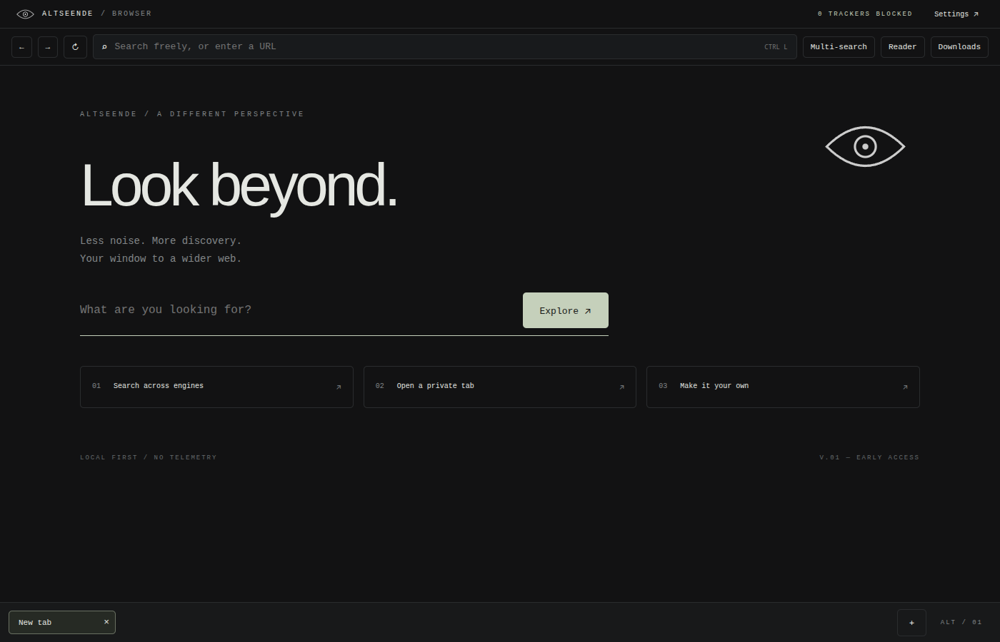

# AltSeende Browser

A black, minimal research browser with bottom tabs and an eye identity. English interface. **0.1.0 alpha**, powered by Electron / Chromium. This is a working first milestone, not a Chromium source fork or a production-hardened browser.



## Run

Node.js 22+ and npm are required for source development.

```sh
npm ci
npm start
```

On Linux, a graphical desktop and Chromium sandbox support are required. Keep the sandbox enabled. `npm run pack` builds `dist/AltSeende-linux-x64/AltSeende`, which runs without Node.js installed separately.

## Available in this milestone

- Real web pages in isolated Chromium WebContentsViews; bottom tabs, back/forward/reload, new windows routed to tabs.
- Google, Yandex, DuckDuckGo, Bing and Brave search; one query across selected engines.
- Query builder: exact phrase, exclusions, domain, file type and date. Provider support for operators varies.
- Regular persistent profile and separate private in-memory tabs; no app telemetry or saved browsing-history database.
- A small built-in tracker hostname blocklist, HTTPS upgrades, DNT/GPC headers, restricted WebRTC UDP, denied site permissions, clear storage/cache.
- Reader for selected text, page text or pasted text, with voice and speed controls. Requires system speech voices; availability varies by OS.
- Discovery/download of direct video links plus a manual URL field and session download progress. Native save dialog chooses destination.
- Experimental unpacked Chrome extensions, remembered between launches and removable from Settings.
- Accent, density, typeface and configurable application keyboard shortcuts.

## Honest boundaries

Electron supports only a subset of Chrome extension APIs. Chrome Web Store installation, arbitrary Chrome extensions, extension toolbar popups and full Manifest V3 compatibility are not delivered. See [Electron extension support](https://www.electronjs.org/docs/latest/api/extensions).

Video discovery only inspects the top-level document for direct MP4/WebM/OGG/MOV links. DRM, blob URLs, HLS/DASH streams, authenticated extraction and “every video on every website” are not supported.

This is not an anonymity browser. Websites see your IP. The small blocklist is not a comprehensive ad/tracker filter; fingerprint resistance, third-party-cookie controls and secure DNS UI are future work. Private tabs share a session until application exit. Downloads and explicitly installed extensions are persistent; private mode does not erase downloaded files. No automatic updater, Safe Browsing service, password manager or security audit is included. Keep Electron current before routine browsing. Camera, microphone, geolocation and notification permissions are currently always denied.

## Shortcuts

| Action | Default |
| --- | --- |
| New tab | Control+T |
| Close tab | Control+W |
| Address | Control+L |
| Multi-search | Control+Shift+F |
| Private tab | Control+Shift+N |

Shortcuts are application-local. Edit them in Settings with unique Control+[Shift+][Alt+]Letter combinations.

## Verification

`npm test` covers search composition, URL scheme restrictions, HTTPS behavior and tracker hostname boundaries. `npm run smoke` opens the actual app with an isolated temporary profile and a local HTTP fixture, checks renderer isolation, private-cookie separation, tab lifecycle, multi-search and settings, and captures `docs/preview.png`. It requires a graphical desktop. Tests do not certify security or third-party site/extension compatibility.

## Architecture and next checkpoints

`src/main.cjs` owns tabs, sessions, permissions and validated shell-only IPC; `preload.cjs` exposes a small command bridge only to the local UI. Remote pages have sandboxing/context isolation enabled and no Node or preload bridge. `core.cjs` contains pure search/URL policy functions. The UI has a restrictive Content Security Policy and no remote fonts or scripts.

1. **0.1 — this milestone:** runnable visual direction and core research flows.
2. **0.2 — after design feedback:** richer search profiles, custom engines, tab groups, bookmarks and granular permissions.
3. **0.3:** maintained filter lists, media extraction integration, speech improvements and packaging for additional operating systems.
4. **Architecture checkpoint:** choose between continuing Electron with documented extension limits or migrating to a Chromium source fork for full browser extension integration.

User settings live in Electron's OS-specific `userData` directory under AltSeende Browser. Source assets and the eye SVG are bundled locally.
