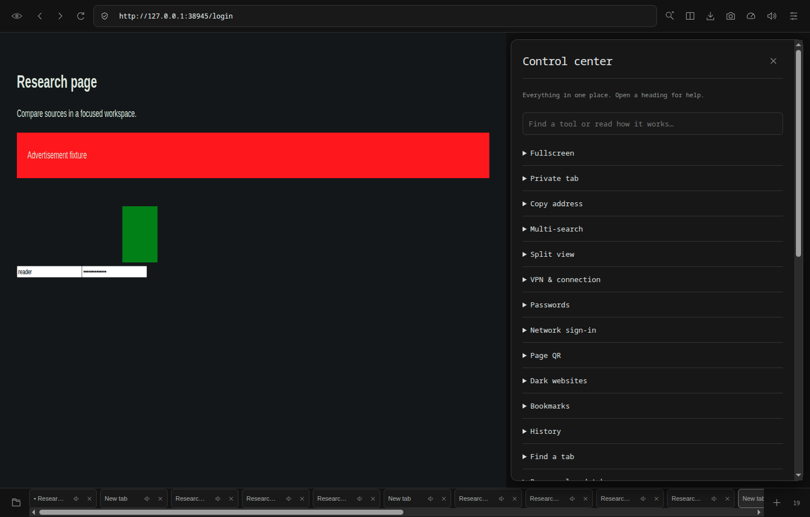
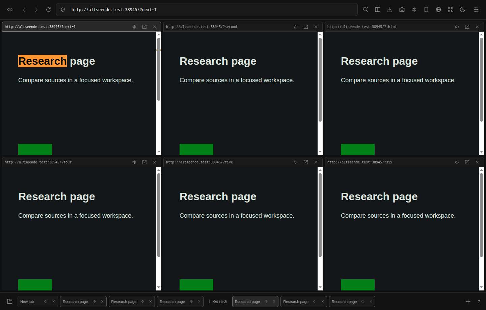

# AltSeende Browser

A minimal, English-language Chromium browser for research. **Version 0.4.0** uses Electron 44 with sandboxed web pages, bottom tabs and an eye identity.


## Download and run

Open [Releases](https://github.com/DanielSnadon/AltSeendeBrowser/releases) and select a Linux x64 download. The repository is private, so sign into an account with access.

- **Fedora RPM:** open the `.rpm` with the software installer. After installing, launch **AltSeende Browser** from the application menu.
- **AppImage:** enable executable permission in file properties and run it. If FUSE 2 is missing, use `./AltSeende-0.4.0-x86_64.AppImage --appimage-extract-and-run`.
- **Portable archive:** extract the full `.tar.gz` and run `altseende-browser` inside. Keep the bundled files together.

Node.js is not required for these downloads. These packages target Linux x64. Windows packaging is configured (`npm run dist:win`) but is not part of the Linux release and has not been tested on Windows.

## What changed in 0.4

- Monochrome interface, subtle motion, icon controls and compact side sheets. Opening preferences leaves the page visible beside them.
- The top split icon opens a quick native menu: choose 2–6 pages, 1–3 columns or individual tabs without opening preferences. Advanced multi-search still opens all six engines in a 3 × 2 layout.
- **Control center** (sliders at the far right): searchable tools, instructions and direct launch buttons. Preferences remains available there. Toolbar tools can be selected and reordered.
- **VPN & connection:** bundled sing-box 1.14.2 core. Import NekoBox/nekoray-compatible VLESS (including REALITY), VMess, Trojan, Shadowsocks, SOCKS5 and HTTP(S) profile links. TCP, WebSocket and gRPC transports are supported; unsupported transports/plugins are rejected. Other NekoBox configurations can be used through its local SOCKS5 endpoint.
- Connections cover browser page traffic and downloads, not the whole computer. Bring your own server/profile; there is no included server, subscription service or guaranteed access to blocked websites. The local tunnel running is not proof that the remote server works. No automatic direct fallback: a core crash blocks new page requests. After restart, previously protected browsing stays blocked until you unlock/reconnect or explicitly disconnect. Server hostname lookup and maintenance downloads (filter updates) can use the system connection. Portal sign-in intentionally bypasses the tunnel. This is not a system-wide VPN or a complete anonymity guarantee.
- **Passwords:** manual local entries with exact-origin, user-triggered fill (no form submission), strong password generation, delete and temporary clipboard copy. AES-256-GCM encryption with a scrypt-derived master key; passwords and connection profiles share a vault. Auto-lock after five minutes of vault inactivity. No silent credential harvesting, cloud sync, iframe fill, password recovery or completed security audit. Remember the master password; copy expires after 30 seconds only if clipboard contents are unchanged (clipboard history managers can retain it).
- **Network sign-in:** isolated temporary window for captive Wi-Fi portals using an explicit HTTP connectivity probe. It uses a direct connection and permits HTTP redirects, while normal browsing keeps its privacy settings. Connect to Wi-Fi through the OS first; close sign-in when finished, then reconnect the tunnel.
- **Page QR:** generated offline from the active address; save as PNG.
- **Dark websites:** local Dark Reader processing, remembered per origin. Complex pages may need the toggle turned off; external image analysis is disabled.
- **Bookmarks:** search, rename, open, remove, import and export AltSeende JSON.

Ten additional tools: local history, reopen closed tab (Ctrl+Shift+T), duplicate tab, pin tab, find a tab, read-later list, page notes, clean-link copy, bookmark import and bookmark export. History excludes private tabs and keeps 1,000 entries. Reopen remembers the last 25 closed regular tabs for this run. Reading lists store links, not offline page copies. Notes are local plaintext and unavailable on private tabs.

Regular tab volume, mute and pin state survive restart. HTML audio/video players, including iframe players, follow per-tab volume; Web Audio synthesis follows native mute only.



### Remove or update on Fedora

To uninstall the installed RPM:

```sh
sudo dnf remove altseende-browser
```

This removes the installed application; profile data, source code and downloaded installer files remain. AppImage/portable copies are separate files, not RPM installations.

To install or update from a downloaded RPM in the current directory:

```sh
sudo dnf install ./AltSeende-0.4.0-x86_64.rpm
```

No need to uninstall before upgrading.

## What changed in 0.2

- **Ad blocker:** EasyList, EasyPrivacy and RU AdList, with both network cancellation and cosmetic CSS hiding, including dynamic page elements. Filters are bundled for offline startup; update them manually in Settings. Toggle blocking with the checkbox in Settings; open pages reload to apply the change. No acceptable-ads allowlist.
- **Split views:** select 2–6 open pages from the split icon. Click a page or its pane address to activate it. Each pane has a full address, focus control and close button. Multi-search opens results in a group and can arrange them side by side.
- **Minimal chrome:** one icon toolbar with accessible labels and hover hints. The address bar reflects redirects and the active split pane, and updates correctly after navigation.
- **Configurable tools:** show, hide and reorder multi-search, split view, downloads, screenshots, speed, Reader, groups, home and private-tab controls in Settings. All tools remain accessible from Settings.
- **Session restore:** regular tab URLs, active tab, groups and split layout are saved atomically and restored. Private tabs are never serialized. Disable restore in Settings to clear the saved session. Scroll position, form contents and back/forward history are not restored.
- **Tab groups:** create, rename, reassign or dissolve groups through the folder icon at bottom left.
- **Home spaces:** change the home heading, show/hide preset cards, and create/edit/delete named URL sets. Save currently open regular pages into a preset and reopen them together, optionally side by side. At most six panes are visible; additional preset pages remain normal tabs.
- **Images:** right-click an image and select **Save image as…** or **Copy image**.
- **Screenshots:** the camera icon saves the visible viewport of the active page to PNG. In split view it captures the active pane; full-page scrolling screenshots are not implemented.
- **Connection speed:** the gauge icon runs an explicit 8 MB download estimate against Cloudflare, with request latency. It is not an upload test or continuous network monitor.



## Existing features and boundaries

Search engines: Google, Yandex, DuckDuckGo, Bing, Brave and Yahoo. Advanced query builder includes exact phrases, exclusions, domain, file type and date. Provider support for search operators varies.

Reader supports selected/page/pasted text, voice and rate controls. Actual speech requires installed system voices. Video downloads find direct MP4, WebM, OGG and MOV URLs in the top-level document; DRM, blob URLs and HLS/DASH extraction are not supported.

Experimental unpacked Chrome extensions can be loaded in Settings. Electron supports only part of Chrome's extension API; Chrome Web Store and full Manifest V3 compatibility are not included.

A blocker cannot guarantee every ad disappears. This implementation supports network and CSS filtering; scriptlets and extended procedural selectors are not implemented. Filter updates are manual and can break some pages; disable the blocker for troubleshooting.

This is not an anonymity browser. Without a tunnel, sites see your normal public IP; with a working tunnel, they normally see the server IP. Permissions for camera, microphone, geolocation and notifications remain denied by default; HTTP is upgraded to HTTPS unless disabled. DNT/GPC are signals, not enforcement. Private tabs share an in-memory session until app exit; downloaded files remain on disk. There is no automatic updater, Safe Browsing service or completed security audit. The tunnel and encrypted password vault have the boundaries described above.

## Develop and verify

Requires Node.js **22.12+** (Node 24 recommended) and a graphical Linux desktop.

```sh
npm ci
npm run filters
npm run tunnel
npm start
npm test
npm run smoke
npm run test:restart
npm run dist
```

`npm run dist` generates AppImage, RPM and portable archive in `dist/installers/`. `launch.sh` prefers the unpacked current build if available.

Unit tests cover URL policy, queries, private-session serialization, pane geometry and bundled filter behavior. `npm run test:restart` also closes and relaunches the actual application with an isolated profile to verify persistence. The real-Electron smoke test verifies isolation, ad blocking on/off (network and CSS), address updates, Reader transfer, video/image downloads, screenshot capture, split activation, cookies, session restore logic, groups, presets and toolbar customization. It uses an isolated temporary profile and local fixtures; it does not certify third-party site compatibility. The split-view documentation image composites captures of the shell and actual page surfaces because Electron's shell capture omits child views.

The GitHub Actions workflow builds downloadable Linux installers after code pushes to `main`, then creates a release for a new package version. Repeated builds of the same version remain available as workflow artifacts instead of replacing published installers.

## Source layout

- `src/main.cjs`: sessions, views, IPC validation, persistence, downloads and tools.
- `src/renderer.js`, `style.css`, `icons.js`: local interface, no remote fonts/scripts.
- `src/content-preload.cjs`: isolated cosmetic filtering bridge, no website-facing API.
- `src/filters.cjs`: list download, compilation and loading.
- `src/workspaces.cjs`: private-safe session snapshots and pane geometry.
- `src/core.cjs`: query construction and URL policy.

Settings and session data live in Electron's `userData` directory for AltSeende Browser. Existing 0.1 preferences are preserved. Filter source/licensing details are in [THIRD_PARTY.md](THIRD_PARTY.md).

## Connection and vault data

Linux profile data lives in `~/.config/AltSeende Browser/`. `vault.json` is encrypted; settings, notes, bookmarks and history are ordinary local JSON. Back up the vault file together with your master password stored separately. Uninstalling the RPM does not erase this profile.

The tunnel binary is downloaded from a pinned upstream release with SHA-256 validation during the build. The installer ships its license and corresponding source archive in `resources/tunnel/`. Profile configuration is passed over stdin and is not written to a plaintext config file. Connection profiles are not exposed in renderer state.

Verification includes unit tests, Chromium integration tests with real local pages, exact-origin password fill, a real local HTTP proxy reached through the bundled tunnel, tunnel-crash blocking, and a full-process restart with a locked vault and protected routing. External VPN servers and real captive networks require testing with your own provider/network. Documentation screenshots combine native page captures with the shell capture because Electron captures these surfaces separately.
